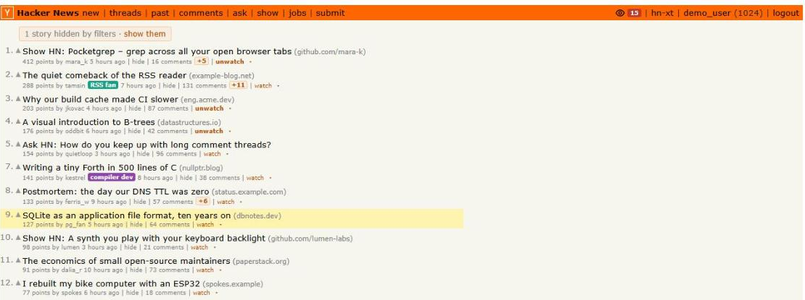
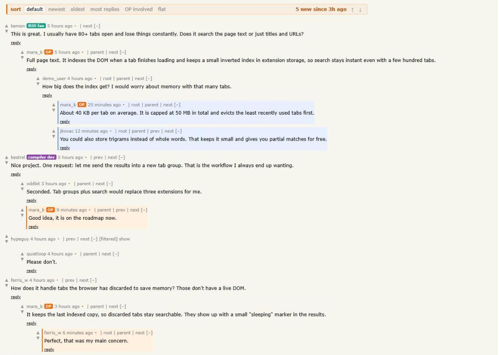
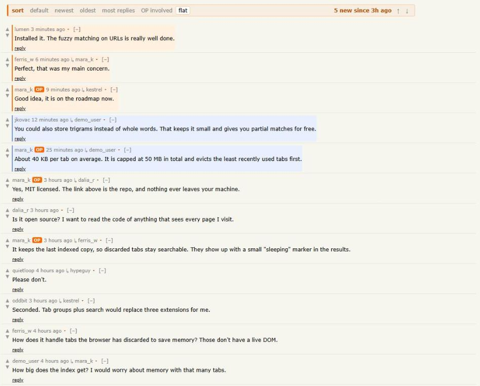
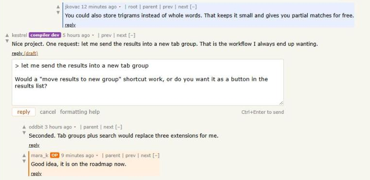
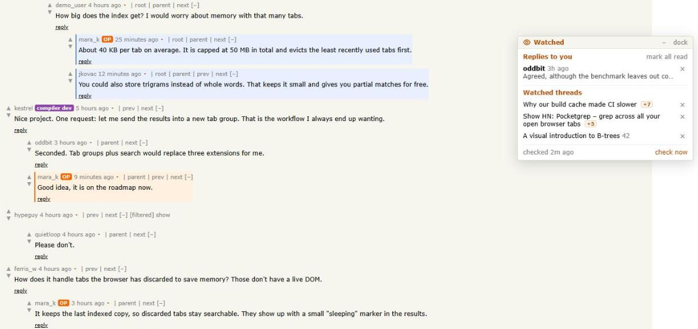
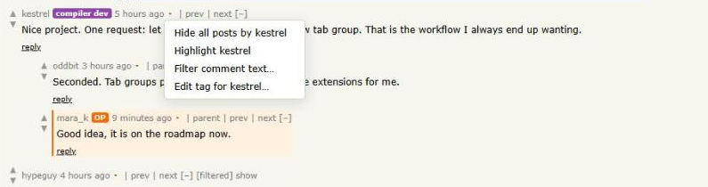
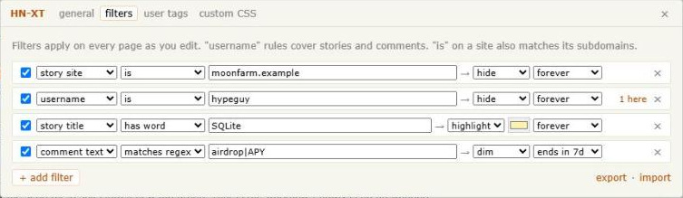

# HN-XT

A userscript for Hacker News, loosely modelled on 4chan X: comment sorting, new-comment tracking, a thread watcher with reply notifications, filters, user tags and custom CSS.



## Install

Requires Tampermonkey or Violentmonkey.

```sh
npm install
npm run build
```

Then open `dist/hn-xt.user.js` in your browser, or drag it into the userscript manager. Settings live under the **hn-xt** link in HN's header.

## Features

### Comment sorting

A toolbar above every thread lets you sort comments by HN's default order, newest, oldest, most replies, or "OP involved" (branches the original poster replied in come first). Replies always stay under their parent, and HN's collapse links keep working.

**Flat** mode lists every comment newest first, with a link to the comment it replies to. It's useful for catching up on a busy thread.





### Inline replies

Clicking **reply** opens a reply box under the comment instead of a new page. Select text in a comment before clicking to quote it. <kbd>Ctrl</kbd>+<kbd>Enter</kbd> sends. Drafts are kept per comment until you send them. After sending, your reply appears in place, wherever the current sort puts it. <kbd>Ctrl</kbd>+click still opens HN's reply page.



### New comments

Comments posted since your last visit are highlighted. <kbd>N</kbd> and <kbd>Shift</kbd>+<kbd>N</kbd> jump between them. Replies to your own comments are highlighted in blue, and story lists show `+N` next to threads you've already opened.

### Thread watcher

Click **watch** under any story. The eye icon in the header opens a list of watched threads with their new-comment counts, plus recent replies to your posts. You can also get desktop notifications for replies.

The list can be detached into a floating window that you can drag anywhere. It stays open as you browse, and there's an option to always start it detached.

Checks run every few minutes while an HN tab is open, against the official HN API. If you have several tabs open, only one of them polls.



### Filters

Each story and comment gets a small ▾ menu with actions like hiding a user or site, highlighting a user, or making a filter from the text you've selected.



Rules are built from dropdowns rather than written as regex, although regex is available. They can hide, dim or highlight, can expire after a set time, and show how many items each one matches on the current page. Hidden stories are counted in a bar at the top, and hidden comments leave a stub you can expand, so nothing disappears without a trace.



### Also

- **User tags:** label any user with a coloured badge that appears wherever their name does.
- **Custom CSS:** applied live, after HN's styles and HN-XT's own.
- **Infinite scroll:** story lists load the next page as you reach the bottom.
- **Backup:** export everything to a JSON file and import it on another machine.

## Development

```sh
npm run dev     # dev build with hot reload, installed via the link Vite prints
npm run build   # type-check and build dist/hn-xt.user.js
```

Code layout:

- `src/hn/`: reading HN pages (comment tree, stories, current user) and the HN API
- `src/features/`: one module per feature
- `src/ui/`: header links, settings, menus, toolbar, small DOM helpers

Things about HN that shaped the code:

- HN's Content-Security-Policy blocks page scripts from calling other hosts, so API requests go through `GM_xmlhttpRequest`.
- Comments are flat sibling `<tr>` rows. Nesting comes only from an `indent` attribute, and HN's collapse hides the following rows with a deeper indent. Sorting therefore keeps each subtree contiguous.
- Item IDs only increase, so sorting by ID is sorting by time, and "new since last visit" just stores the highest ID seen.
- When you're logged in, HN's `[–]` collapse is saved to your account.

The screenshots use made-up stories and users. `docs/screenshots/demo.js` swaps them into a real HN page so the shots can be retaken.
